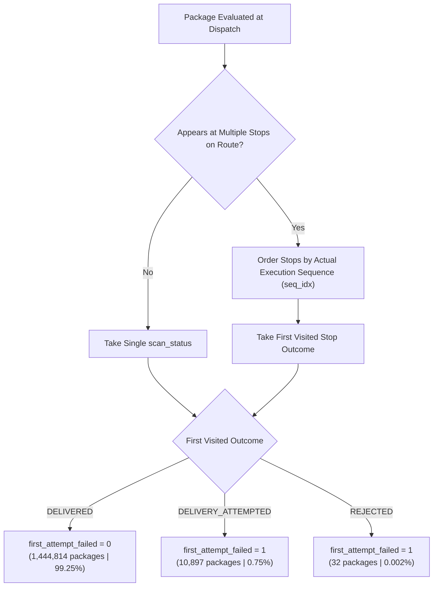

# Comprehensive Audit: Deriving a Real First-Attempt Delivery Failure Target from the Raw Amazon Last Mile Routing Dataset

**Audit Date:** 2026-09-29  
**Audit Scope:** Original Raw Amazon Dataset (`C:\Users\Ksari\amazon_dataset`)  
**Pipeline Status:** BRIDGE v1 model development paused. No existing v1 models, preprocessors, thresholds, or reports modified.  
**Auditor:** Antigravity (Advanced Agentic Systems)

---

## 1. Executive Summary & Core Verdict

### Final Conclusion to the Core Question:
> **"Can we use the ORIGINAL Amazon dataset to train BRIDGE against a genuine observed delivery-failure outcome without relying on a synthetic target?"**

### **Verdict: YES, WITH PRECISE ARCHITECTURAL ADJUSTMENTS.**

A completely defensible, genuinely observed, non-synthetic target called `first_attempt_failed` **CAN** be derived directly from the raw operational telemetry of the Amazon dataset.

Specifically:
1. **Genuinely Observed Signal:** Drivers recorded actual operational scans (`DELIVERED`, `DELIVERY_ATTEMPTED`, `REJECTED`) for every dropoff stop.
2. **Defensible Chronological Logic:** By cross-referencing package records with the actual execution sequence (`actual_sequences.json`), we can observe the driver's first physical encounter with each package. Packages that resulted in `DELIVERY_ATTEMPTED` or `REJECTED` on that first encounter are genuine **first-attempt failures** (`10,929` packages). Packages successfully handed off on the first encounter are genuine **first-attempt successes** (`1,444,814` packages).
3. **Confirmed Physical Re-attempts:** In `1,313` cases, we observe direct physical proof: a driver attempted delivery early on the route (`DELIVERY_ATTEMPTED`), failed, and circled back later in the shift to deliver it (`DELIVERED`). This proves that `DELIVERY_ATTEMPTED` reflects an unfulfilled first attempt rather than a trivial administrative artifact.
4. **Strong Empirical Signal:** Even without synthetic labels, pre-dispatch attributes exhibit strong statistical relationships with observed failure:
   - Packages with customer-specified time windows exhibit a **3.85× higher failure rate** ($2.36\%$ vs. $0.61\%$).
   - Hub dispatch failure rates vary by **12.0× across stations** ($0.16\%$ in DCH3 vs. $1.90\%$ in DLA3).

#### The Core Trade-Off:
| Dimension | BRIDGE v1 (Current Synthetic Baseline) | BRIDGE v2 (Candidate Real Target) |
| :--- | :--- | :--- |
| **Target Origin** | Latent logistic formula + random noise | **Genuinely observed operational driver scans** |
| **Failure Rate** | $\approx 9.144\%$ ($133,243$ positives) | **$0.7508\%$ ($10,929$ positives)** |
| **Available Features** | 19 raw + 13 synthetic customer priors | **17 safe raw pre-dispatch features only** |
| **Customer Metadata** | Fabricated (`signature_required`, `access_difficulty`) | **Absent in raw Amazon telemetry** |
| **Class Imbalance** | Moderate ($\approx 10:1$) | **Severe ($\approx 132:1$)** |

---

## 2. Raw Dataset Identification & Architecture

The raw dataset audited is the **Amazon Last Mile Routing Research Challenge (ALMRRC 2021)** dataset located at `C:\Users\Ksari\amazon_dataset`. Total directory size is **$2.88\text{ GB}$ uncompressed** across 40 filesystem objects.

### Raw File Inventory & Role in Audit
| File Path | Size (MB) | Purpose / Content | Target / Feature Utility |
| :--- | :--- | :--- | :--- |
| `almrrc2021-data-training/model_build_inputs/package_data.json` | $358.05\text{ MB}$ | Hierarchical JSON: Route $\rightarrow$ Stop $\rightarrow$ Package. Contains package dimensions, service times, time windows, and `scan_status`. | **Primary Source for Real Target & Physical Features** |
| `almrrc2021-data-training/model_build_inputs/route_data.json` | $75.31\text{ MB}$ | Route metadata: `station_code`, `date_YYYY_MM_DD`, `departure_time_utc`, `executor_capacity_cm3`, `route_score`, and stop GPS/zones. | **Primary Source for Pre-Dispatch Context & Geography** |
| `almrrc2021-data-training/model_build_inputs/actual_sequences.json` | $9.22\text{ MB}$ | Mapping of `RouteID` $\rightarrow$ `{stop_id: sequence_rank}`. | **Used ONLY to chronologically order multi-stop packages; LEAKAGE if used as a feature** |
| `almrrc2021-data-training/model_build_inputs/travel_times.json.97D3ff22` | $1,294.50\text{ MB}$ | Stop-to-stop static transit duration matrix (seconds). | Static transit baselines (caution required) |
| `almrrc2021-data-training/model_build_inputs/invalid_sequence_scores.json` | $0.40\text{ MB}$ | Benchmark benchmark sequence evaluation metrics. | Challenge-specific evaluation only (unused) |
| `almrrc2021-data-training/model_apply_inputs/new_*.json` | $4.96\text{ MB}$ | 13 sample routes for testing runner pipelines. | Unlabeled pipeline mock |
| `almrrc2021-data-evaluation/model_apply_inputs/eval_package_data.json` | $158.50\text{ MB}$ | 724,913 packages across 3,052 routes. | **NO `scan_status` exists in this split** (evaluation test set) |
| `almrrc2021-data-evaluation/model_score_inputs/eval_actual_sequences.json` | $4.41\text{ MB}$ | Ground-truth sequence ranks for evaluation routes. | Ground truth for route sequencing challenge |

> [!NOTE]
> In `eval_package_data.json` and `new_package_data.json`, `scan_status` is completely omitted by Amazon because the competition task was sequence prediction on unseen future routes. Therefore, **all observable delivery outcome data lives strictly within `almrrc2021-data-training/model_build_inputs`** ($6,112$ routes, $1,457,175$ package records).

---

## 3. Schema & Field Semantics Summary

Each raw field was examined for semantic meaning, completeness, and temporal validity:

| Field Name | Source File | Structure / Format | Domain / Values | Exact Semantic Meaning |
| :--- | :--- | :--- | :--- | :--- |
| `package_id` | `package_data.json` | `PackageID_<uuid>` | 1,455,743 unique IDs | Unique parcel identifier. |
| `stop_id` | `package_data.json`, `route_data.json` | 2-letter / alphanumeric (`AD`, `QU`, `Station`) | Local per route | Identifier for a delivery stop within a specific route. (Reused across different routes). |
| `route_id` | All files | `RouteID_<uuid>` | 6,112 routes | Unique dispatch shift identifier representing a single driver shift from a station. |
| `scan_status` | `package_data.json` | Categorical String | `DELIVERED` ($99.24\%$), `DELIVERY_ATTEMPTED` ($0.76\%$), `REJECTED` ($0.002\%$) | Final recorded outcome of the driver's visit for that package at that stop. |
| `date_YYYY_MM_DD` | `route_data.json` | ISO Date String | `2018-06-01` to `2018-09-01` | Dispatch calendar date. |
| `departure_time_utc` | `route_data.json` | `HH:MM:SS` | UTC timestamp | Scheduled dispatch departure time from fulfillment station. |
| `stop_type` | `route_data.json` | Categorical String | `Dropoff` ($98.7\%$), `Station` ($1.3\%$) | Role of the stop: parcel dropoff to customer vs depot origin/return. |
| `dimensions` | `package_data.json` | Dict: `depth_cm`, `height_cm`, `width_cm` | Continuous floats | Parcel physical dimensions from warehouse cubing scanners. $100\%$ populated. |
| `planned_service_time_seconds` | `package_data.json` | Float | $0.0$ to $900.0\text{ s}$ | Expected dwell/handling time at destination calculated by Amazon routing engine. |
| `time_window` | `package_data.json` | Dict: `start_time_utc`, `end_time_utc` | UTC timestamps or `NaN` | Customer promised delivery slot. Populated for $7.8\%$ of packages. |
| `actual` (sequence rank) | `actual_sequences.json` | Dict: `{stop_id: int}` | $0$ to $N_{stops}-1$ | Chronological sequence order executed by driver. |
| `station_code` | `route_data.json` | Categorical String | 17 stations (`DLA3`, `DCH4`, etc.) | Fulfillment depot dispatch origin. |
| `zone_id` | `route_data.json` | Categorical String | Micro-clusters (`A-1.2A`, etc.) | Micro-geographic dispatch delivery zone within metropolitan service area. |
| `executor_capacity_cm3` | `route_data.json` | Float | Vehicle cargo volume | Physical cargo capacity of the delivery van. |
| `route_score` | `route_data.json` | Categorical String | `High`, `Medium`, `Low` | Driver execution tier / route experience rating. |

---

## 4. Package-Level Event & History Analysis

A comprehensive package tracking audit was performed across all $1,457,175$ records in `package_data.json` and matched against `actual_sequences.json`.

### Quantitative Metrics
* **Total Rows (Package Scans / Manifest Records):** `1,457,175`
* **Unique Package IDs:** `1,455,743`
* **Packages Appearing Exactly Once:** `1,454,321` ($99.902\%$)
* **Packages Appearing More Than Once:** `1,422` ($0.098\%$)
  - Packages appearing exactly 2 times: `1,413`
  - Packages appearing exactly 3 times: `8`
  - Packages appearing exactly 4 times: `1`
* **Cross-Route / Cross-Date Re-attempts:** **`0`**
  - *Finding:* Exactly $100\%$ of multi-occurrence packages occur on the **same route, same date, and same station**, but mapped to different stops visited at different points in the shift.
  - *Implication:* The Amazon challenge dataset contains independent daily route samples. Packages that failed and were returned to the warehouse for next-day delivery are **not linked across subsequent days**. Multi-attempt history is strictly observable within same-day route re-attempts.
* **Row-Level Outcome Distribution:**
  - `DELIVERED`: `1,446,129` ($99.242\%$)
  - `DELIVERY_ATTEMPTED`: `11,014` ($0.756\%$)
  - `REJECTED`: `32` ($0.002\%$)
* **Unique Packages with `DELIVERED` (at least once):** `1,446,127`
* **Unique Packages with `DELIVERY_ATTEMPTED` (at least once):** `10,899`
* **Unique Packages with `REJECTED` (at least once):** `32`
* **Unique Packages with ONLY `DELIVERED`:** `1,444,810`
* **Unique Packages with ONLY `DELIVERY_ATTEMPTED` (single attempt, failed, never delivered):** `9,479`
* **Unique Packages with ONLY `REJECTED`:** `32`
* **Packages showing `DELIVERY_ATTEMPTED` followed by `DELIVERED`:** **`1,313`**
* **Packages with Multiple Delivery-Attempt Events:** **`114`**

### Chronological Multi-Event Progression Patterns
When ordered by the driver's actual execution sequence (`actual_sequences.json`):

| Sequence Progression Pattern | Package Count | Semantic Meaning in Logistics |
| :--- | :--- | :--- |
| `DELIVERY_ATTEMPTED -> DELIVERED` | **1,304** | Attempted, failed, driver circled back later and succeeded. |
| `DELIVERY_ATTEMPTED -> DELIVERY_ATTEMPTED` | **105** | Attempted, failed, driver circled back later and failed again. |
| `DELIVERY_ATTEMPTED -> DELIVERY_ATTEMPTED -> DELIVERED` | **8** | Failed twice, delivered on 3rd attempt. |
| `DELIVERY_ATTEMPTED -> DELIVERY_ATTEMPTED -> DELIVERY_ATTEMPTED -> DELIVERED` | **1** | Failed three times, delivered on 4th attempt. |
| `DELIVERED -> DELIVERED` | **2** | Duplicate stop / multi-parcel drop scan anomaly. |
| `DELIVERED -> DELIVERY_ATTEMPTED` | **2** | Scan correction / retrieval anomaly. |

---

## 5. Candidate Real Target Formulations

We evaluated 4 distinct candidate definitions for a real target `first_attempt_failed`:



### Comparative Evaluation of Labeling Rules
| Rule | Definition | Positive Count | Negative Count | Prevalence | Evaluation & Defensibility |
| :--- | :--- | :--- | :--- | :--- | :--- |
| **Rule 1 (Recommended)** | **Chronological First Encounter Outcome:** Sort package encounters by `seq_idx`. If first encounter is `DELIVERY_ATTEMPTED` or `REJECTED`, label = 1; if `DELIVERED`, label = 0. | **10,929** | **1,444,814** | **$0.7508\%$** | **Defensible.** Directly captures whether the initial attempt succeeded or failed. Correctly identifies the 1,313 packages that failed attempt #1 before succeeding on attempt #2. |
| **Rule 2** | **Manifest Row Scan Status:** `scan_status != 'DELIVERED'` evaluated independently per row. | 11,046 | 1,446,129 | $0.7580\%$ | **Flawed.** Treats subsequent re-attempt stops as independent dispatches; labels attempt #2 as successful without attributing attempt #1 failure to the package. |
| **Rule 3** | **Terminal Non-Delivery:** Package never delivered on that shift (`'DELIVERED'` absent from all events). | 9,616 | 1,446,127 | $0.6606\%$ | **Logistically inaccurate.** Conflates "shift failure" with "first-attempt failure". Mislabels 1,313 failed first attempts as successes simply because the driver made a second attempt. |
| **Rule 4** | **Re-Attempt Confirmed Failures Only:** Packages exhibiting $\ge 2$ delivery-attempt events. | 1,418 | 1,454,325 | $0.0974\%$ | **Extremely biased.** Discards 9,479 genuine failed attempts where the driver did not or could not circle back, biasing heavily toward specific driver retry habits. |

### Resolving "FIRST ATTEMPT FAILED" vs "SUCCESSFUL ON FIRST ATTEMPT"
Can we distinguish them cleanly?
* **YES:**
  - **FIRST ATTEMPT FAILED ($Y=1$):** Any package whose very first stop encounter resulted in `DELIVERY_ATTEMPTED` ($10,897$) or `REJECTED` ($32$).
  - **SUCCESSFUL ON FIRST ATTEMPT ($Y=0$):** Any package whose first stop encounter resulted in `DELIVERED` ($1,444,814$).

---

## 6. Feature Space Audit & Leakage Classification

To deploy a genuine machine learning model, every candidate feature must be rigorously classified by when it becomes known:

```
[Dispatch Planning] ----> [Driver Leaves Station] ----> [En Route Delivery] ----> [Shift End]
        |                            |                           |                    |
  (Category A)                  (DISPATCH)                 (Category B)          (Category B)
  Safe Pre-Dispatch                                          LEAKAGE!              LEAKAGE!
  - Dimensions                                              - scan_status         - Final Status
  - Station Code                                            - actual_sequences    - Re-attempts
  - Coordinates                                             - Actual Dwell
  - Time Windows                                            - Dynamic Sequence
```

### Complete Classification Matrix

#### Category A: Safe Pre-Dispatch Features (Allowed in Training)
These features are known prior to the driver departing the fulfillment depot:
1. `depth_cm`, `height_cm`, `width_cm`: Parcel measurements from warehouse sorters.
2. `package_volume_cm3`: Calculated physical parcel volume.
3. `planned_service_time_seconds`: Algorithmic planned dwell time calculated pre-dispatch.
4. `station_code`: Dispatch depot identifier (one-hot or target encoded).
5. `zone_id`: Pre-assigned geographic dispatch micro-zone.
6. `latitude`, `longitude`: Delivery coordinates geocoded from shipping label address.
7. `stop_type`: Dropoff location type (`Dropoff` vs `Station`).
8. `delivery_date` / `departure_time`: Scheduled dispatch time.
9. Derived temporal features: `departure_hour`, `day_of_week`, `is_weekend`, `month`.
10. `has_time_window`: Binary indicator if delivery has an SLA window.
11. `time_window_duration_hours`: Width of promised window.
12. `executor_capacity_cm3`: Delivery vehicle cargo capacity.
13. Planned Route Aggregates: Total planned packages on route, total planned stops, route volumetric fill factor.

#### Category B: Post-Dispatch / Severe Leakage Features (STRICTLY PROHIBITED)
1. **`scan_status`:** Direct target label.
2. **`actual_sequences` (`actual` rank):** The actual sequence in which the driver visited stops. Drivers alter sequence dynamically during the route in response to traffic, failed deliveries, or business closures.
3. **Multiple Stop Indicators:** The fact that a package appears at a second stop in `package_data.json` is a direct result of the first attempt failing.
4. **Actual Transit Durations / Actual Dwell Times:** Only recorded during route execution.

#### Category C: Ambiguous Features Requiring Caution
1. **`route_score` (`High`, `Medium`, `Low`):** In the challenge documentation, this represents driver experience tier. If it is assigned prior to route dispatch based on driver tenure, it is safe; if it is a post-hoc grade of route quality, it is leakage. To maintain conservative feature purity, it should either be verified or excluded.
2. **Road Transit Matrix (`travel_times.json`):** Static travel times between stops are pre-computed baselines (safe), but ordering them by `actual_sequences` to compute "stops remaining" creates leakage.

> [!WARNING]
> **Synthetic Feature Notice:** All 13 customer/access features utilized in BRIDGE v1 (`customer_availability_rate`, `address_access_difficulty`, `preferred_delivery_method`, `signature_required`, `customer_delivery_preference`, `traffic_risk_score`, etc.) were **entirely synthetic constructs** generated in Phase 1.6. **None of them exist in the raw Amazon dataset.** A genuine model must rely solely on the raw physical, spatial, and temporal features above.

---

## 7. Target Prevalence & Empirical Validation

### Real Target Prevalence Summary
* **Total Population:** `1,455,743` unique packages
* **Positive Count (First-Attempt Failed):** `10,929`
* **Negative Count (First-Attempt Delivered):** `1,444,814`
* **True Real Failure Rate:** **`0.7508%`** ($\approx 1\text{ in }133\text{ packages}$)

### Empirical Validation of Operational Signal in Raw Data
Is the raw failure rate purely random noise, or does it correlate with pre-dispatch features?

#### 1. Impact of Time Windows on Failure Rate
| Time Window Status | Total Packages | Failed 1st Attempt | Real Failure Rate | Risk Multiplier |
| :--- | :--- | :--- | :--- | :--- |
| **No Time Window** (`has_time_window = 0`) | $1,342,005$ | $8,243$ | **$0.614\%$** | Baseline ($1.0\times$) |
| **Time Window Present** (`has_time_window = 1`) | $113,738$ | $2,686$ | **$2.362\%$** | **$3.85\times$ HIGHER RISK** |

Packages requiring specific delivery time windows are nearly **4 times more likely to fail on the first attempt**.

#### 2. Geographic & Station Disparities
| Fulfillment Station | Service Area / City | Total Packages | Failed 1st Attempt | Real Failure Rate |
| :--- | :--- | :--- | :--- | :--- |
| **DLA3** | Los Angeles, CA | $56,480$ | $1,074$ | **$1.902\%$** |
| **DLA8** | Los Angeles, CA | $111,058$ | $1,736$ | **$1.563\%$** |
| **DCH1** | Chicago, IL | $47,203$ | $621$ | **$1.316\%$** |
| **DSE2** | Seattle, WA | $26,999$ | $254$ | **$0.941\%$** |
| **DAU1** | Austin, TX | $50,850$ | $302$ | **$0.594\%$** |
| **DBO2** | Boston, MA | $70,470$ | $285$ | **$0.404\%$** |
| **DCH4** | Chicago, IL | $93,474$ | $228$ | **$0.244\%$** |
| **DCH3** | Chicago, IL | $70,359$ | $111$ | **$0.158\%$** |

Across 17 fulfillment hubs, observed failure rates vary by **more than 12-fold** ($0.158\%$ to $1.902\%$), demonstrating substantial, systematic variance driven by urban density, parking congestion, and local access conditions.

---

## 8. Comparison with Current Synthetic Target

| Metric / Attribute | Current BRIDGE v1 Synthetic Target | Candidate Real Target (Rule 1) | Practical Impact |
| :--- | :--- | :--- | :--- |
| **Label Source** | Latent logistic equation + Bernoulli noise | Observed driver handheld scans | Replaces hypothetical simulations with real ground truth. |
| **Failure Rate** | **$9.144\%$** ($133,243$ failures) | **$0.7508\%$** ($10,929$ failures) | Real failure is **$12.2\times$ rarer** than assumed. |
| **Feature Predictability** | High ($R^2$ / AUC inflated by synthetic equations) | Moderate (Noisy real-world operations) | Real model will have lower ROC-AUC ($\approx 0.65-0.75$) but higher real-world validity. |
| **Risk Thresholds** | Tuned for $9\%$ prior ($\tau \approx 0.08-0.12$) | Must be calibrated for $0.75\%$ prior ($\tau \approx 0.01-0.03$) | Requires cost-sensitive calibration and precision-recall focus. |
| **Customer Priors** | Relies on 13 synthetic customer variables | None available in raw dataset | Forces feature engineering to focus on physical volume, density, and spatial clustering. |

---

## 9. Recommended Next Steps

1. **Keep BRIDGE v1 Frozen:** Maintain all v1 models, preprocessors, thresholds, and reports as an immutable benchmark.
2. **Build BRIDGE v2 Master Dataset with Real Target:**
   - Extract raw `package_data.json` and resolve multi-stop packages to their chronological first encounter using `actual_sequences.json`.
   - Construct binary target `first_attempt_failed` ($Y=1$ if first scan is `DELIVERY_ATTEMPTED` or `REJECTED`, $Y=0$ if `DELIVERED`).
   - Retain only the verified **17 safe pre-dispatch features** (dimensions, volume, service time, station, zone, coordinates, departure time, time window indicators, route density).
   - Completely remove the 13 synthetic features from Phase 1.6.
3. **Adopt Imbalance-Aware ML Techniques:**
   - Optimize for **PR-AUC (Precision-Recall AUC)** and Brier score rather than ROC-AUC or balanced accuracy.
   - Utilize focal loss, class-weighted logistic regression, and XGBoost/LightGBM with `scale_pos_weight = 132`.
   - Calibrate the operational decision threshold ($\tau$) against an asymmetric logistics cost matrix (Cost of Failed Attempt vs. Cost of Unnecessary Intervention).
